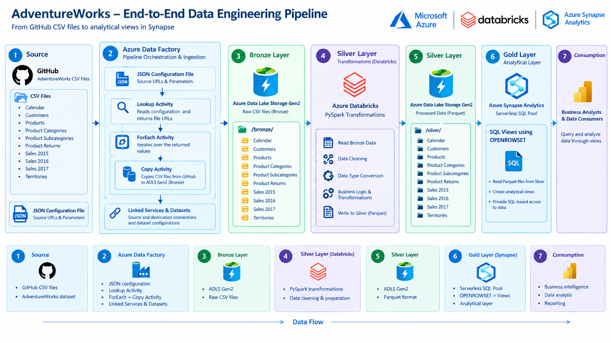

# AdventureWorks End-to-End Data Engineering Project

An end-to-end data engineering project built using Microsoft Azure services to ingest, transform, and prepare AdventureWorks data for analytical querying using a Medallion Architecture.

## Project Overview

This project demonstrates a cloud data engineering workflow using Azure Data Factory, Azure Data Lake Storage Gen2, Azure Databricks, PySpark, and Azure Synapse Analytics.

The pipeline ingests AdventureWorks CSV files from GitHub into the Bronze layer using a configuration-driven Azure Data Factory pipeline. Azure Databricks transforms the raw data using PySpark and stores the processed datasets in Parquet format in the Silver layer. Azure Synapse Analytics Serverless SQL Pool uses `OPENROWSET` to query Silver Parquet files and expose the data through SQL views in the Gold layer.

## Architecture



*The architecture diagram illustrates the end-to-end data flow, from GitHub source files through Azure Data Factory ingestion, Bronze storage, Databricks transformations, Silver storage, and Synapse Gold views.*

## Technologies Used

| Technology                   | Purpose                                         |
| ---------------------------- | ----------------------------------------------- |
| Azure Data Factory           | Pipeline orchestration and data ingestion       |
| Azure Data Lake Storage Gen2 | Bronze and Silver data storage                  |
| Azure Databricks             | Distributed data processing                     |
| PySpark                      | Data cleaning and transformation                |
| Azure Synapse Analytics      | Serverless SQL querying and analytical views    |
| SQL and `OPENROWSET`         | Querying Parquet files directly from ADLS       |
| JSON                         | Source URL and parameter configuration          |
| Parquet                      | Columnar storage for processed data             |
| GitHub                       | Source data hosting and project version control |

## Dataset

The project uses the AdventureWorks dataset, which contains business data related to customers, products, sales, returns, and territories.

**Dataset source:** [AdventureWorks on Kaggle](https://www.kaggle.com/datasets/ukveteran/adventure-works)

The datasets include:

- Calendar
- Customers
- Products
- Product Categories
- Product Subcategories
- Product Returns
- Sales 2015
- Sales 2016
- Sales 2017
- Territories

## Data Engineering Workflow

### 1. Source Data — GitHub

The AdventureWorks CSV files are hosted in a GitHub repository and used as the source for the ingestion pipeline.

A JSON configuration file stores source file URLs and related parameters, allowing the pipeline to process multiple files dynamically.

### 2. Data Ingestion — Bronze Layer

Azure Data Factory orchestrates the ingestion process and copies the source CSV files into the Bronze container in Azure Data Lake Storage Gen2.

The pipeline uses the following components:

- **Lookup Activity:** Reads the JSON configuration and retrieves the source URLs and parameter values.
- **ForEach Activity:** Iterates over the values returned by the Lookup Activity to process multiple source files.
- **Copy Activity:** Copies the CSV files from GitHub into the Bronze layer.
- **Linked Services:** Define connections to the source and destination systems.
- **Datasets:** Define the source and destination data configurations.

This configuration-driven approach makes the ingestion process reusable and reduces the need to create separate pipelines for individual files.

### 3. Data Transformation — Silver Layer

Azure Databricks processes the Bronze data using PySpark.

The `SilverTransformations` notebook contains the code for connecting to ADLS Gen2, reading source data, and applying data transformations.

The processed datasets are stored in the Silver container in Parquet format, providing a structured data layer for downstream analytical querying.

### 4. Analytical Data Access — Gold Layer

Azure Synapse Analytics Serverless SQL Pool is used to query Silver Parquet files directly from Azure Data Lake Storage Gen2.

SQL views are defined using `OPENROWSET`, allowing the data to be accessed through SQL without first loading the files into dedicated database tables.

This layer provides a SQL-based interface for querying the processed datasets and preparing them for analytical use.

### 5. Data Consumption

The SQL views provide a queryable interface for downstream analysis and reporting tools.


## Repository Structure

Adventure_Works_Project/
│
├── ADF/
│   ├── ARMTemplateForFactory.json
│   ├── ARMTemplateParametersForFactory.json
│   └── linkedTemplates/
│
├── Databricks/
│   └── SilverTransformations.py
│
├── Synapse_SQL/
│   └── GoldViews
│   └── CreateSchema
│
├── data/
│   └── AdventureWorks CSV files
│
├── Architecture/
│   └── Architecture.png
│
└── README.md
```

## Key Features

- Configuration-driven ingestion of multiple CSV files.
- Dynamic file processing using Lookup, ForEach, and Copy activities in Azure Data Factory.
- JSON-based source URL and parameter management.
- PySpark transformations using Azure Databricks.
- Medallion Architecture with Bronze, Silver, and Gold layers.
- Parquet storage for processed Silver datasets.
- Direct querying of data lake files through Synapse Serverless SQL and `OPENROWSET`.
- SQL views for downstream analytical access.

## Project Status

- **Bronze Layer:** Ingestion pipeline implemented.
- **Silver Layer:** PySpark transformations implemented, with processed data stored in Parquet format.
- **Gold Layer:** SQL views developed using `OPENROWSET`.

## Future Improvements

- Implement incremental data loading and watermark management.
- Add data quality checks and automated validation.
- Expand the Gold layer with additional business-oriented analytical views.
- Integrate downstream reporting and visualization tools.

## Project Links

- **GitHub Repository:** [Adventure_Works_Project](https://github.com/ahmedeldaly594/Adventure_Works_Project)
- **Dataset Source:** [AdventureWorks Dataset on Kaggle](https://www.kaggle.com/datasets/ukveteran/adventure-works)
